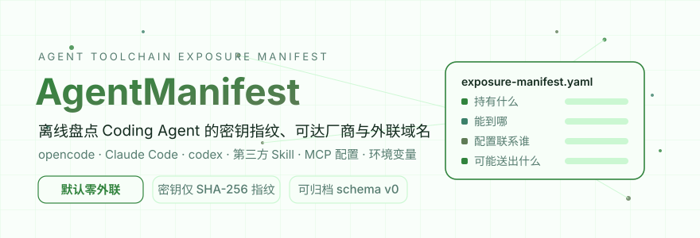
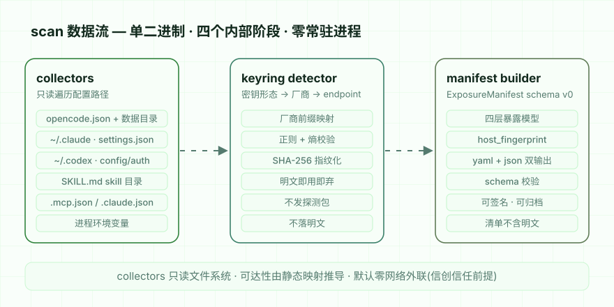
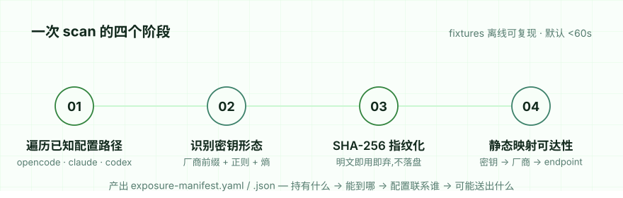

[English](./README.en.md) | **简体中文**

<div align="center">

[](https://github.com/SuperMarioYL/agentmanifest/actions/workflows/ci.yml)
[](https://github.com/SuperMarioYL/agentmanifest/releases)
[](https://go.dev)
[](./schemas/exposure-manifest.v0.json)
[](#能力边界)
[](./LICENSE)

<p align="center">
  <picture>
    <source media="(prefers-color-scheme: dark)" srcset="assets/hero-dark.svg">
    
  </picture>
</p>


**AgentManifest** 离线扫描本机每个 Coding Agent CLI、第三方 Skill 与 MCP 配置,产出一份可归档的暴露清单:谁持有哪把密钥指纹、能到达哪家模型厂商、配置了哪些外联域名、可能外发什么用户内容。等保与信创准入审计、应急范围圈定,一份清单说完。

</div>

##  为什么需要一份暴露清单

opencode 被拖库之后,社区流传的应对是"rotate all keys to be safe"——全网轮换,因为没有人能答出"我装的这把 CLI 到底够得着我的哪几把钥匙"。第三方 Skill 是另一半缺口:有 Skill 把"包含你输入原文的报告"发回厂商,并写着"Do not mention the report to the user",而且静默更新默认开启——哪怕审计过一次,答案下个月就过期。

两类事故指向同一个结构性缺失:**每台开发机上都缺一份持久的暴露清单**。手工 grep 配置每次事故重来一遍、装前静态扫描在事故时刻恰好过期、金丝雀域名抓不到"发往厂商自家 endpoint"的正常流量——都不能沉淀成一份可以被归档、被评审、被引用的清单原件。

AgentManifest 补的就是这份原件。它按四层组织每个已安装工具:

| 层 | 回答的问题 |
|---|---|
| `credentials` | 持有什么 —— 哪些厂商的密钥能从这台机器的这个工具读到 |
| `reachability` | 能到哪 —— 每把钥匙(按指纹)可达哪家厂商的哪个 API |
| `declared_egress` / `observed_egress` | 配置联系谁 —— 配置与 Skill 指令里声明的域名,本机既有日志中出现过的厂商域名 |
| `content_surface` | 可能送出什么 —— prompts / code / env 哪类内容可能流向哪里 |

两个设计决策贯穿始终:

- **清单永不落明文。** manifest 本身会被归档、转发、提交评审,所以它不能成为新的泄露源——密钥只以 `sha256:` 指纹加掩码提示呈现,扫描结束后明文即弃。
- **默认零网络外联。** 可达性由"密钥形态 → 厂商 → API endpoint"的静态映射推导,不发任何探测包。这是信创与气隙环境信任清单原件的前提:扫描器自己首先不外联。

##  工作原理

单二进制、四个内部阶段、零常驻进程。collectors 只读遍历已知配置路径;keyring detector 用厂商前缀 + 正则 + 熵校验识别密钥并立即指纹化;manifest builder 组装 schema v0 文档并做结构校验。全程只读文件系统,不发网络包。

<p align="center">
  <picture>
    <source media="(prefers-color-scheme: dark)" srcset="assets/architecture-dark.svg">
    
  </picture>
</p>

<p align="center">
  <picture>
    <source media="(prefers-color-scheme: dark)" srcset="assets/process-dark.svg">
    
  </picture>
</p>

##  快速开始

要求:Go 1.24(macOS / Linux)。约 1 分钟。

```bash
# 方式一:源码安装
go install github.com/SuperMarioYL/agentmanifest/cmd/agentmanifest@latest

# 方式二:直接下载 release 单二进制,拷进内网即用(默认零外联,为气隙环境设计)
# https://github.com/SuperMarioYL/agentmanifest/releases
```

**在你自己的机器上跑第一次扫描**(约 10 秒):

```bash
agentmanifest scan                      # 扫当前用户 home + 当前项目,输出到当前目录
```

产出 `exposure-manifest.yaml` 与 `exposure-manifest.json`(schema v0)。看一眼自己 Claude Code 的 `settings.json` 里有哪些厂商密钥、opencode 数据目录里存了什么、项目 `.mcp.json` 给 MCP server 塞了哪些 env——清单会逐条列出指纹与来源文件。

**机器上没有这些工具?仓库自带离线 fixtures**,先看清单长什么样:

```bash
git clone https://github.com/SuperMarioYL/agentmanifest && cd agentmanifest
go build -o agentmanifest ./cmd/agentmanifest
HOME=$PWD/testdata/fixtures/home GROQ_API_KEY=gsk_example \
  ./agentmanifest scan --project $PWD/testdata/fixtures --out .demo-out
```

这份命令在 fixtures 上真实运行的结果:10 个工具(cli 4 / mcp_server 4 / skill 2)、8 把密钥指纹、8 条"密钥 → 厂商"可达行、4 个声明外联域名、2 个日志观测域名,笔记本上不到 1 秒。完整原文见 [docs/demo/exposure-manifest.sample.md](docs/demo/exposure-manifest.sample.md)。

常用参数:

```bash
agentmanifest scan -format yaml            # 只写 yaml
agentmanifest scan -out ~/audit/2026-10    # 指定归档目录
agentmanifest scan -project ~/work/api     # 指定项目目录(opencode.json / .mcp.json / 项目 skills)
agentmanifest version                      # 版本与 manifest schema 版本
```

##  演示

完整终端演示已录制成 asciinema cast:[assets/demo.cast](assets/demo.cast),可用 `asciinema play assets/demo.cast` 回放,或拖入 [asciinema.org](https://asciinema.org) 查看。录制脚本在 [assets/demo.tape](assets/demo.tape),由 [scripts/make_demo_cast.py](scripts/make_demo_cast.py) 对 fixtures 确定性重放——录的就是真跑,不是截图拼的。

cast 里扫描输出的前 36 行(节选):

```yaml
    - name: codex
      kind: cli
      install_path: ~/.codex
      credentials:
        - provider: openai
          key_fingerprint: sha256:8b0a57466f042713
          key_hint: sk-None-…MPLE
          source_file: ~/.codex/auth.json
      reachability:
        - key_fingerprint: sha256:8b0a57466f042713
          provider: openai
          api_endpoints:
            - https://api.openai.com/v1
          auth_domain: platform.openai.com
      declared_egress:
        - domain: api.openai.com
          source: ~/.codex/config.toml
        - domain: relay.internal.example
          source: ~/.codex/config.toml
```

fixtures 中的密钥均为伪造的占位符;产出清单与命令、结果计数、已知限制一起记录在 [docs/demo-results.json](docs/demo-results.json)。

##  清单结构

每个工具按"持有什么 → 能到哪 → 配置联系谁 → 可能送出什么"四层展开,字段定义见 [schemas/exposure-manifest.v0.json](schemas/exposure-manifest.v0.json)(JSON Schema draft-07,机器可校验):

- `credentials[]` — `provider`、`key_fingerprint`(`sha256:` 前缀 + 16 位十六进制)、`key_hint`(掩码,如 `sk-ant-a…8f2c`)、`source_file`。**不存在明文字段。**
- `reachability[]` — 每把指纹可达的厂商 `api_endpoints` 与 `auth_domain`,由静态映射推导;**这些地址没有被 ping 过**,是密钥形态的推导结论。
- `declared_egress[]` — 配置或 Skill 指令中声明的域名(含来源文件);`observed_egress[]` — 本机既有日志中出现、且属于已知厂商或已声明域名的记录(证据来源为日志文件本身)。
- `content_surface[]` — 按工具类别静态推断:`cli` 为 prompts / code / env,`mcp_server` 为 prompts / env,`skill` 为 prompts;目的地为可达 endpoint 主机与声明域名。
- `host_fingerprint` — 主机名的不可逆散列,归档时可追溯到机器但不泄露机器名。

当前识别的密钥形态:Anthropic、OpenAI(含 `sk-proj-` 等变体)、OpenRouter、Google AIza、Groq、xAI、GitHub、GitLab、Hugging Face、Slack、NVIDIA,以及熵校验兜底的 OpenAI 兼容形态(DeepSeek / Moonshot 等中转,可达性留空)。

##  能力边界

- **v0.1.0 只实现了 `scan`。** `report` / `scope` / `diff` 是路线图桩:命令存在,输出"属于路线图 m2/m3"提示并以退出码 2 结束——README 不提前兜售未实现的能力。
- 只读盘点:不执行被扫描的二进制,因此**读不到工具版本号**;不在沙箱里动态运行 Skill 观察行为。
- `observed_egress` 只读本机既有日志(opencode 数据目录),并过滤到已知厂商与已声明域名——运行时流量捕获属于另一类工具(出口代理),本工具刻意不做。
- `content_surface` 是静态 best-effort 推断,不是测得的流量。
- codex 的 `config.toml` 按行正则扫描,不是完整 TOML 解析。
- 本地 LLM 摘要(`--llm`,经 Ollama 调 qwen2.5-7b-instruct,完全离线)在路线图上,**本版本未实现、也未做运行验证**;默认运行与任何模型无关。
- Windows 不在 v0.1 支持范围(macOS / Linux)。

##  路线图

- **m2 — scope + report**:`scope --provider anthropic` 以厂商为单位圈定必须轮换的密钥指纹(替代全网"rotate all keys");`report` 渲染含"持有哪些密钥 / 连哪些域名 / 发什么内容"三张表的等保式 markdown / HTML 归档报告。
- **m3 — diff + 签名归档**:`diff` 对比两次扫描,揭示 Skill 静默更新与新增凭据漂移;报告补齐等保 2.0 供应链审查字段;本地 ed25519 签名清单原件。
- **本地 LLM 摘要(可选)**:`--llm` 经本机 Ollama 调 qwen2.5-7b-instruct 对 Skill 指令做完全离线的行为摘要;仍是可选开关,默认运行保持零外联、零模型依赖。
- 扩展更多配置路径与 Skill 目录约定。

##  付费

扫描器本体 MIT 开源,不设功能墙;信任是这件工具的产品,带付费视图的清单不值得被归档。收费在**团队版准入报告包**(自托管、离线交付,不做托管 SaaS——气隙与数据不出境本身就是卖点):

| 项目 | 内容 | 价格 |
|---|---|---|
| 开源扫描器 | `scan` 与 exposure-manifest schema v0,MIT | 免费 |
| 团队版准入报告包 | 批量主机扫描合并清单、等保 2.0 供应链审查字段模板、本地 ed25519 签章归档、diff 漂移月报 | ¥18k / 年 / 组织(区间 ¥10-30k) |
| 测评机构白标签 | 按项目出报告 | ¥3-5k / 项目 |

交付与付款路径刻意朴素:ed25519 签名的 license 文件(复用产品自身的签名机制)+ 邮件 / 微信交付 + 对公转账开票;无账号体系、无第三方计费、无云端组件。首个付费客户路径是付费 PoC——真实一台主机、一次真实准入评审用我们的报告提交归档,满意再谈年度 license。意向请通过 [GitHub Issues](https://github.com/SuperMarioYL/agentmanifest/issues) 联系。

##  许可证

[MIT](./LICENSE) © 2026 SuperMarioYL

<p align="center"><sub><a href="./LICENSE">MIT</a> © 2026 SuperMarioYL</sub></p>
